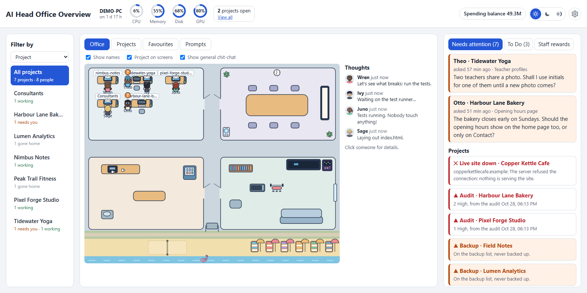
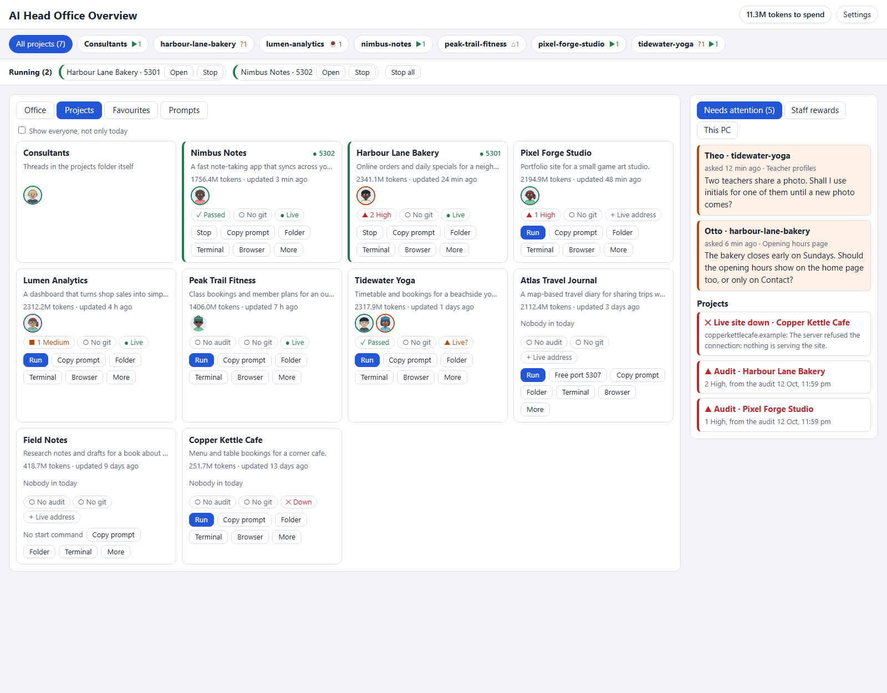
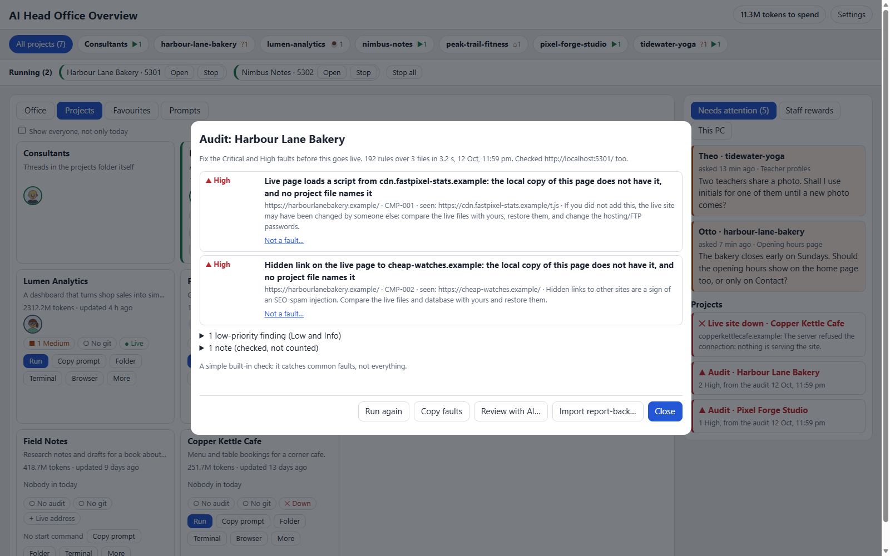

# AI Head Office Overview 0.1.2 (Windows)

Your AI coding threads as staff in a little office, beside the projects they work on. Each thread is a person at their
project's desk: working, thinking, standing with a question for you, or gone home. Next to them, each project has
its own tile: run its local copy, open its folder, a terminal or the browser, and see three marks: a built-in
**audit** for common security faults, its **git** backup state and its **live site**. One **Needs attention** list
holds everything waiting for you: threads with a question, live sites down, serious audit findings, and work not yet
saved or pushed in git.

It runs only on your PC. It reads the AI app's transcripts already on your PC and never changes or sends them; the
only requests that leave your PC are plain page requests to the live addresses you add (and, only if you turn it on,
a daily check with GitHub for the newest Git version).



Using an AI helper to install, review or update it? **[AGENTS.md](AGENTS.md)** has the steps it should follow,
including how to see what an update changes before pulling it.

## What you need

- **Windows 10 or 11** with **Microsoft Edge** (it ships with Windows).
- **Node.js 22 or newer**: `install.cmd` checks, and offers to install the LTS version for you with winget
  (Windows' own installer). Or get it from <https://nodejs.org>, default options. Nothing else to install: no npm
  packages, no admin rights.
- An AI coding app that keeps its threads as transcripts in `%USERPROFILE%\.claude\projects` (Claude Code does). The
  project side works without it; the office then has no staff.

## Install and start

1. Download or clone the repository, and put the folder **inside the folder that holds your projects** (for example
   `C:\Users\you\projects\ai-head-office-overview`): on its first start the office lists the folders next to it.
   Anywhere else works too; you then add your projects folder under **Settings › Folders**.
2. Double-click **`install.cmd`**. It checks Node.js (and offers to install it), asks whether you want a desktop
   shortcut and to start the office when you sign in to Windows (Enter = yes), sets up the start link, then starts the
   office. It opens in its own window. A small console window titled "AI Head Office Overview" starts minimised: that
   is the office itself.
3. The very first start reads every transcript once (about half a minute for a few hundred threads); the page shows
   people as they are read, today's first.

Already have Node.js? Double-clicking **`start.cmd`** works too: a **Welcome** window then offers the same shortcut and
Start with Windows. From then on, open it from the desktop icon, from **`index.html`** (click **Start office**), or at
<http://127.0.0.1:8880/> while it runs.

**Stop it:** Settings › About › **Quit**, or close the minimised console window. Either one stops the office and every
local copy it started. From a command line: `node server.js --stop`, and `node server.js --status` (exit code 0 =
running).

## The window

- **Top line:** the name, then **This PC** as rings (CPU, memory, disk and graphics card, each its share with the
  number inside; point at one for the details, at the PC name for its model, cores and time switched on), then
  **N projects open · View all** (a window with every local copy the office started: its address, **Open** and
  **Stop**, and **Stop all**; its foot says these are copies on your own PC, and stopping one does not touch a thread
  at work); on the right, **Spending balance** (the tokens to spend on Staff rewards), the colours
  switch (**sun** = light, **moon** = dark, **sun hugged by the moon** = auto) and **Settings** (the gear).
- **Auto colours** (the default): light from sunrise to sunset, dark at night. The times come from this PC's time
  zone (its main city, or roughly from the zone's offset), so they are close, not exact, and nothing is looked up
  online. Point at the auto button to see today's sunrise and sunset.
- **A room bought** (Staff rewards, or a click on a locked room): the IT tech walks in and unlocks its door, then
  everyone with nothing to do runs in, jumping and spinning, for a few seconds; whoever is busy cheers from their desk.
- **Furniture bought:** a fitter carries it in and sets it up, and it shows in the room once they have. Several pieces
  bought together are set up one after another.
- **Treats** (pizza, donuts, sandwiches, coffee): each order comes in with its own courier, so pizza, donuts and coffee
  bought together all arrive. The foods sit side by side on the kitchen table. Whoever gets something turns to face you
  and waves a thank-you.
- Above Filter by, **Show names** (the staff's names under them in the office) and **PC name** (the project's name above each desk's
  computer): untick either to see the staff better, or for a screenshot. Remembered in this browser.
- **Filter by** (left of the office), with a choice of **Project**, **Working folder** or **Category**. What it picks is
  what every tab shows: the office, the Projects tiles, Favourites and Thoughts (prompts are not per project). Project:
  **All projects**, then each project with someone in today and, in words, who is doing what ("1 working · 1 needs you").
  Working folder: each folder from Settings › Folders with its projects and people today. Category: the project
  planner's categories (below), each with how many projects are in it, and **Categories…** to manage them. Click one to
  see only that.
- **Office** tab: the office seen from above. Each thread is a person at their project's desk (the project folder they
  write files in, or the one their first message says START HERE in); a thread that works in two or more projects is
  a **Consultant** at the projects folder's own desk. Working is at the desk; a thread that stopped to ask you
  something stands with a "?"; a long think goes to the meeting room once it has one; after an hour with nothing
  happening they go home. Favourites wait on a beach towel. Click anyone for their card.
  Someone waiting for your reply for a while goes to try out what has been bought (a lounge spot, a free deck chair) and
  stays there enjoying it, the "?" above them all the while, until your reply comes; then they hurry back to the desk.
  Those resting keep one spot for a few minutes before they move on.
  Beside the office, **Thoughts**: a chat, like a team chat. Each message has its writer's small head on the left and
  arrives a moment after the last (1 to 2 seconds apart), newest at the bottom. Cheers and thanks for treats (a coffee
  and a donut together get dunked), a thought when they settle somewhere ("These deck chairs are nice"), and a line
  about their work, made from what their thread is doing ("PHP in progress… thinking about loops?"). When their thread
  hits a real snag, they quip about it, out loud and in the chat: a step that ended in an error ("Red, not green. Back to
  it.") or the AI saying it found a bug ("Whoever wrote this code got this wrong. …Oh. It was me."); at most one every
  few minutes each. It follows Filter by. Click someone to see them instead.
- **Projects** tab: a tile per project, its staff as faces on the left. Its name has a star after it (click to make it a
  favourite project) and, on the same line, **Run** (starts the project's own dev server and opens it) or **Stop**
  beside the port. When another program holds its port, Run becomes **Re-allocate**: it starts the project on the
  next clean port (one no other project uses) instead of stopping that program, and keeps that port for next time while
  the old one stays taken, so moves stay rare; the start port is always tried first. Under them: its **Audit / Git /
  Live** marks with **Browser** and **More** at their end (a project with no live site shows **+ Live URL**). **More**
  holds: **Free port N** when another program holds its port (it names that program and asks before stopping it),
  **Copy prompt**
  (its name and full folder, to paste into the AI you use; the office never starts an AI itself), **Folder**,
  **Terminal**, **Hide** (stays on the list, out of view until **Show hidden** is ticked) and **Remove from list** (its
  folder and files are never touched; Settings › Folders brings it back).
- **The project planner**, on the Projects tab: so no project is forgotten and the important ones get real time.
  - **Today**, at the top: the day split from your hours a day. Ready to ship first (built, waiting only for an upload;
    no time), then paid care, then the **focus three** with their time (#1 gets half; #2 and #3 share the rest by
    score), then the end of the day: one medium project for 40 min, the check-ins due, and one low project for a
    20-minute "still works?" check. The medium and low ones are those that have waited longest, never picked at
    random, and they stay for the day once picked (**Plan again** picks them afresh). Check-ins are answered with
    **Fine for now** (its wait starts again), **Needs work** (+20 to its score until someone works on it) or **Park it**
    (off the board), here or under Needs attention.
  - **The score**, the number before each tile's name: it opens the score window. Five sliders (profit 30, demand 25,
    what it means to you 20, few competitors 15, little marketing needed 10; a project not scored yet counts 50),
    Needs work, a deadline (a hard date puts it at the top), up to two categories, and the stage: **Ready to ship**,
    **Shipped** or **Handed over** (its handover starts), **Sold** (moved to the buyer's category, its handover starts),
    **Back to building**, and **Park it** / **Bring it back**. Each tile also shows today's part, Needs work, its stage
    ("Handover · day 12 of 30"), a deadline, how long it has waited and its categories, each in words.
  - **Categories** (Today › Categories…, or Filter by › Category): who projects are for ("My projects", a client), with
    the owner and the care plan their finished projects get (handover days and minutes, then weekly, daily or no
    check-ins, and whether the owner pays: paid care goes at the top of the day). Changing a care plan first names
    every project it changes, with **Change all**, **Only projects added from now on** or **Cancel**.
  - **Hours and rules…**: hours a day (default 8), calendar or working days for a handover, a handover for your own
    sites too, and whether paid care also lifts a score.
  - The search box above the tiles finds a project by its name or either category; **Order** puts them **By priority**.
- **Favourites** tab: your starred people and projects.
- **Prompts** tab: prompts you use again and again, a tile per category. Inside one, the prompts are tiles a third wide,
  each with a **star** (☆/★: starred prompts come first, and show under **Starred** above the categories), **Copy**,
  **Edit** (which can move it), **Remove**; **New category**, **Add prompt**, **Rename** and **Delete category**; search across them all. Words in
  [brackets] are yours to fill in.
- **Right panel:** **Needs attention** (threads with a question first, then projects: a live site down, Critical or
  High audit findings, git waiting for a save or push; click a row to open it; and today's **check-ins** from the project
  planner, each with Fine for now, Needs work and Park it) and **Staff rewards** (spend the purse: coffee, plants,
  furniture, room keys; **Transaction history** folds open to list what was bought lately, when, and for how much).
- **A person's card:** a star beside their name and one on their project's heading (click to make them, or the whole
  project, a favourite; point at a star to read what that does), **EDIT** (their name and look; both belong to the
  seat, so the next thread at that desk is the same person) and under it **Actions** (Run or Stop, Copy prompt, Folder,
  Terminal, Browser, Hide, Remove from list), what they are doing now, **Earnings** (helpers and tokens today, since
  the office opened and in all; click to fold it open), their last messages and steps, **Open** in the AI desktop app
  when it has a record of the thread, and their project's marks.



### Audit, Git and Live

Each mark opens its window:

- **Audit**: the last audit's findings by severity (◆ Critical, ▲ High, ■ Medium, ○ Low), **Run again**, **Copy faults**
  (one line each, safe to paste into an AI), **Not a fault…** (sets one place aside with your reason; it comes back if
  that line changes; **Bring back** undoes it), **Review with AI…** (a prompt to paste into the AI you use, and the
  faults it reports) and **Import report-back…** (its Findings and False flags tables).
- **Git** (read only: the office never commits, pushes or changes a folder): ● backed up, ▲ unsaved, not pushed or only
  on this PC, ○ no git; the exact commands to copy for a terminal, and **See what changed**: every changed line since
  the last save, to read before you commit.
- **Live**: the address the project is hosted at, checked when the office starts and every 5, 10 or 15 minutes with one
  plain request: ● up, ▲ unsure, ✕ down.



## Settings

- **Folders**: working folders (every folder inside one is a project), projects added one by one, projects taken off the
  list (bring one back), **Scan folders**.
- **Setup**: step 1, the desktop shortcut, Start with Windows and the start link; step 2 (advanced), the AI app's
  hooks, below.
- **Office**: the theme (**Auto**, **Light**, **Dark**, or **Match Windows**, which follows Windows' own light or dark setting;
  dark dims the office itself too), the projects folder the desks come from, the gone-home time, how often live sites
  are checked.
- **Private details**: what an audit looks for in what you would publish (your email, phone, street, full name). Typed
  once and never shown again; a finding shows only its label.
- **Help** and **About** (the version, the Git program's own security state, Quit, Uninstall).

### Easy or advanced setup

**Easy** (the default) reads the transcripts every 3 seconds and changes nothing in the AI app. Its limits: "Needs you"
is worked out from the last reply (one whose last lines ask a question), a permission prompt may not show at all, and
what someone is doing can be up to 3 seconds behind.

**Advanced** also adds three small hooks to the AI app's settings file (`%USERPROFILE%\.claude\settings.json`): when a
thread gets a message, waits for your permission or finishes a reply, the app runs `office/hook.mjs`, which tells the
office at once. It sends only to 127.0.0.1, prints nothing back, and gives up in under a second if the office is
closed. Hooks you already have stay exactly as they are, a copy of the file is saved first, and **Go back to easy
setup** takes out only this office's three (they carry the mark `--ai-head-office-hook`). Other apps' hooks are never
counted, changed or removed. `AGENTS.md` has the same steps for an AI helper asked to do it by hand.

## Demo

Double-click **`start-demo.cmd`** to try it with a made-up office, without touching your own: nine fictional projects,
each with a real little website on your PC, two already running and one held by "another program", six made-up live
addresses (served on your PC too) so the lights show up, unsure and down, and eight made-up staff at their desks
(working, waiting with a question, finished, gone home, a Consultant). It runs on <http://127.0.0.1:8882/> with its own
data (`data-demo`), shows the PC as DEMO-PC and paths as `C:\Users\demo\...`, never reads your real transcripts, and
only pretends to change shortcuts or hooks. Settings › About › Quit stops the demo and its sites. Every name and
number in it is made up; the screenshots here come from it.

## Where start commands come from

The office only runs commands stored in files. The page sends a project id and a command number, never command
text. It looks, in order, at:

1. the project's own `.claude/launch.json`;
2. the project's own `project.json`, key `start`;
3. the working folder's `.claude/launch.json`: entries whose arguments point inside the project;
4. the office's own `projects.json`, key `start`.

A start command needs a `port`, so the office can check the port is free and open the right address.

## Names and descriptions: `projects.json`

The office **never writes into a project's folder**. Names, descriptions, live addresses, extra start commands and
audit settings live in the office's own `projects.json`, keyed by folder name. Copy **`projects.example.json`** to
`projects.json` (next to `server.js`) and edit that:

```json
"my-site": { "name": "My Site", "description": "Booking pages for the shop.", "liveUrl": "https://example.com",
             "start": { "name": "dev", "exe": "node", "args": ["server.js"], "port": 3000 },
             "auditSkip": ["old-copy"], "hide": false }
```

`projects.json` is git-ignored, so your own list of project names never ends up in a repository. A folder with no
entry shows its folder name and the first sentence of its README.

## The built-in audit

A simple check on purpose: it catches common core faults, not everything. **Critical or High = fix first;
Medium = a warning; Low and Info = true but rarely harmful** (accessibility polish, search-engine details, working
notes, a test file that checks nothing): they sit folded at the bottom of the audit and never change its verdict.
Each rule keeps a **record** from the places people set aside as not a fault, across all your projects: a rule set
aside in 3 or more files, and more often than it still stands, shows "check this one" beside its findings, and the
audit lists the record of every rule it shows that someone has judged.

- **Code (about 130 rules):** private and API keys (placeholders and made-up keys are told apart), and a key or
  password taken out of the files that an older version in the **git history** still holds (SEC-012: Critical once
  pushed, since anyone with a copy has it; High while it is only on this PC; the key itself is never shown), service keys,
  passwords in code, hosting passwords saved by an editor, request data in SQL (PHP, Node, Python), in
  eval/include/system/shell commands, in unserialize or pickle, choosing a file to read or a place to redirect to;
  outside data going into the page as HTML or run as code; unescaped echo; weak password hashes, `==` on tokens,
  guessable random tokens, unsigned sign-in tokens, a visitor address taken from a header the visitor can write;
  POST forms with no token; uploads with no type check; CORS that trusts any site; certificate checks switched off;
  errors or a debug console shown to visitors; servers bound to 0.0.0.0; phpinfo pages; trackers printed before
  consent; a privacy page that does not name the outside services the site loads from; and `.env`, database dumps,
  backups, archives, logs, package lists, `.git` or an old copy of the site inside a web root (an archive a page
  links to is a download, so it is noted, not counted).
  Also (`lib/rules-more.js`): uploads (an image decoded before its pixel count is checked, a photo kept with its GPS
  details, a cut-off JPEG accepted, a zip or gzip unpacked with no limit, an upload too big reported as "choose a
  file", an upload checked after it is moved, a request body read with no cap); a GET that signs out or changes data;
  sign-in gaps (wrong tries counted per email, a limit keyed on the full IPv6 address or on CF-Connecting-IP from
  anyone, a password changed without the current one or leaving other devices signed in, secrets compared with ==,
  a sign-in state that is optional, a provider's email trusted unverified, a reset form that tells whether an email
  has an account, a check skipped when its secret is empty, a token from the address kept in browser storage,
  SameSite=None with no Origin check, CORS for every subdomain); payments (a capture marked paid without its status,
  a balance read then spent in a second query, a webhook answering 200 to a bad signature, Stripe livemode);
  JSON from a request used unchecked, a typed price cut to whole numbers, rows paged in code, a quantity with no
  ceiling, a CSV export that runs formulas, text cut mid-character, the UTC date used as today, PDF images squashed
  and Latin-1 PDF fonts; keepalive saves too big to send, data files with no ETag, a 429 with no Retry-After, a
  typed address fetched after only filter_var, a build that writes over an existing release zip; JSON printed into a
  script unescaped, a typed link printed as an href, typed text in a regular expression, a log line, a mail header
  or a Host-header link, postMessage to "*", exception text sent to visitors, a command-line tool in the web folder,
  a fixed temp file name, a CDN script with no integrity check; .htaccess rewrites that drop the https redirect,
  php_flag without IfModule, a dot-file rule that blocks /.well-known/; success shown without checking the reply, a
  fixed "Something went wrong", mail() not checked, an empty catch round a save, stored settings parsed outside try,
  delete with no confirm, a Back button that is history.back(), a service worker cache that never changes, checkboxes
  sharing a name without [], a component used without its import; working notes in shipped comments (review ids,
  commits and dates); text under 12px, pop-ups with no role="dialog" and labels not tied to their field.
  Across files (`lib/cross.js`, the project read as a whole): a public form that saves or mails with no per-visitor
  limit or no cap for everyone, a public call to a paid outside service with no cache and no cap; a table that
  requests keep adding to and the clean-up job leaves out; a public link that answers with the whole row; a webhook
  that ignores its handler's failure and answers 200; a release build that copies a whole folder holding notes or an
  installer, or leaves out a file its page links to; a page promising deletion after a time with nothing in the code
  deleting by age; the privacy page against the code (a picture host built in a script, "nothing kept on your
  device" with browser storage in use, a service named that the site no longer loads, outside loads with no privacy
  page at all); one place saving a record without the validator the others run; a row changed or deleted by its
  number alone; an action switch whose admin actions any signed-in person can run; the same price with two values in
  two files; a field the save step does not clean printed raw; deleting a record that leaves its uploads or its baked
  page behind; "forget everything" leaving keys behind; an /api/ address the page calls with no route on the server;
  a feature switched off only in the page's settings; install notes promising an older PHP or Node than the code
  needs; backups or logs written into the web folder with no deny rule for them; a Content-Security-Policy that
  blocks the site's own form or script; long-cached scripts and styles linked with no version; a test file that
  checks nothing.
- The same fault in several release copies of a file is reported once, with the other copies listed.
- **Localhost (only while the copy runs, only localhost addresses):** security headers, session cookie flags, folder
  listing, and whether files like `/.env`, `/.git`, editor FTP settings, `/error_log` or `/backup.zip` can be
  downloaded. A file the local dev server hands out but the project's `.htaccess` blocks on a real server is noted,
  not counted.
- **Live (only with a live address):** the live site's headers (checked there instead of on localhost, since a local
  dev server leaves out what the real server adds; a CSP that limits no scripts counts), https redirects (also for an
  admin folder with its own `.htaccess`), certificate expiry, and whether `/.env`, `/.git/HEAD`, `/error_log`,
  `package.json`, `composer.json` or an old copy at `/old/` can be fetched. Also: the home page's own stylesheet,
  scripts and an API address they call answering without the security headers the page has; a library version with
  known holes in a served script's banner (axios, jQuery, lodash, Moment.js, Bootstrap); a folder listing on the
  folders those files sit in; a made-up address answering 200 (soft 404); no meta description; a canonical address
  that does not answer; robots.txt hiding a page the sitemap asks to index; a sitemap page the project no longer has
  but the host still serves; and no DMARC record on the domain (a DNS lookup). These add about ten paced requests.
- **Live vs local:** the live home page and up to three pages it links to are compared with the same pages of the
  running local copy (or, when it is not running, with the project's files). Anything outside the site that the
  **live** page loads or links to, which the local page does not have and no project file names, is reported: an
  outside script, frame or form target (**High**), a hidden link (**High**, the mark of SEO spam), an inline script
  written to hide what it does (**High**), a script file that differs from yours and reaches a new address (**High**),
  or a visible link or picture (Medium: content you added on the live site explains it). A setting printed only on
  the live site (an analytics tag your code adds there) is named in your files, so it is noted, not counted.
  Live pages are asked **one every 5 seconds** and the compare stops at the first firewall or "too many requests"
  answer, because a burst of requests can get your own address blocked by the host.
- **What publishing would give away about you (the disclosure pass):** your private details (a list you fill in
  under **Audits › Private details**, plus what the office reads from this PC each time: your user name, PC name,
  home folder, git name and email, and your projects folder), the **names of your other projects** (not inside a
  link, and a name that is an ordinary word only when written as a path to it, such as `../notes/`), an **AI or
  prompt trail** (AI tool folders and settings such as `.claude/` or `CLAUDE.md`, handover notes, prompt and revert
  notes, AI sign-offs, thread ids, chat links, "start here" markers naming a note, page copy saying an AI wrote it,
  and a person quoted by name and date; wording credited to "his" or "the owner's" rule counts only inside a
  comment, so a story or a help page stays quiet) and **local paths** that name a user (`C:\Users\<name>\…`). Your
  git name inside a link (`github.com/<name>/<repo>`) is allowed on purpose: it is the public address you publish
  at. It reads what would be
  published: the files git tracks, the files git would add (marked "not in git yet"), every past version of every
  file on every branch, commit messages, the email on every commit (marked already on the remote, not pushed yet,
  or only on this PC), the newest zip in each folder with the zips inside it, an older zip that a file in the
  project links to, and zips that only the git history still holds. Each finding names the first few lines that
  hold the same kind of detail, so fixing one does not hide the rest. Ignored files are not read; a
  folder with no git is read through its `.gitignore`. A private detail or a commit email that is not a noreply
  address is **High** wherever it is. Another project's name, an AI trail or a local path is Medium in what visitors
  are served (pages, scripts, a web folder, a release zip), Low in a file that only lives in the repository (notes,
  tests, tools, docs) and Info when only the git history or a commit message still holds it. **A finding shows the label, never the detail**, so the report is safe
  to paste into an AI. `node tools/disclose.js <folder>` runs the same pass from the command line.
  A handover or other AI working-notes file is one finding (the fix is to keep the file out), naming what its lines
  hold and High when one holds a private detail; the same line in the file, its history and the zips that ship it is
  one finding with the other places listed.
  It also reads file and folder names and zip entry names (a detail in a name is printed as its label), Word, Excel
  and PowerPoint files, UTF-16 text, details written encoded (`%40`, `&#64;`, `@` for @) and minified files up
  to 16 MB (long lines in slices). What it cannot read (PDFs, databases, `.tar.gz`, files over 16 MB) is named in a
  note, never passed over silently. Zips are unpacked up to 300 MB / 20,000 entries per scan, so a "zip bomb" stops
  with a note instead of freezing the office.
- The code rules leave out `node_modules`, `.git`, `vendor`, build and release copies, and test folders.
- **Old copies of the app** inside a project folder are left out too, so a fault is counted once, where the app
  lives: an `original ...` folder, a `...-fixes` copy, `old/` or `backups/`, an unpacked release (a `name-v1.2.3/`
  beside `name-v1.2.3.zip`, or a version folder inside `releases/`), older versions side by side (the highest
  stays), and copies like `my-app/` beside `my-app-php/` in a folder with nothing of its own (the one
  `.claude/launch.json` starts is the app, else the one changed last). The notes name every folder left out and
  why. The private-detail pass still reads a left-out copy that git would publish. To scan one anyway:
  `"auditInclude": ["old"]` in the project's `project.json` (or its entry in the office's `projects.json`).
- **Not a fault…** beside a finding sets that one place aside, with your reason and who checked it. It is kept in
  `data\judged.json` and matched by the line's text: **edit the line and the finding comes back**. The set-aside list
  sits at the bottom of the audit, each with **Bring back**. A judgement must name one place: one for a whole project
  or a whole file is refused, so it can never switch a rule off.
- **Import report-back…** reads a "False flags" table (| Rule | Where | Verdict | Why | What the rule should do |),
  pasted or opened from a file. `false` sets that place aside; `duplicate of <id>` keeps the finding and tags it with
  the id it is already known as; anything else is left alone, and each row that could not be used says why.
- Older set-asides written by hand as `auditAccept` in the office's `projects.json` still work. A project's own
  `project.json` cannot set its findings aside (a download could hide its own faults); if it asks to leave folders out
  (`auditSkip`), the audit names them in its notes.
- **Copy faults** puts the list on the clipboard to paste into the AI you use.
- **Review with AI…** builds a review prompt for the project, for the faults no rule finds (money, grants, what the
  pages promise, who may do what, PDFs, error messages, capacity, time windows, releases): a 13-point checklist, the
  files to read first (money, sign-in and roles, forms, privacy and terms, uploads and exports, release), what the
  scanner already reports and what was set aside. The project is named by its folder only and private details are
  replaced by their labels. Copy it into any AI (the office opens none and sends nothing). The AI answers with a
  **Findings** table (Id | Severity | Category | Where | Evidence | Fix) and a **False flags** table; paste the answer
  into **Import report-back…**. Each finding must name one place (file:line); it goes on the project's fault list in
  `data\faults\` (open, fixed or not a fault, with who and when; a finding imported again keeps its status).

## Safety and privacy

- The office listens on **127.0.0.1 only**, refuses any other host name, and every request must carry a key that
  changes each run, so other websites cannot use it. The one exception is the advanced-setup hook, which may only
  report an event as JSON (a web page elsewhere cannot send that here).
- **Nothing about you or your projects is sent anywhere.** The window loads nothing from outside the office. The only
  requests that leave your PC are plain page requests (GET, no cookies, no sign-in) to the live addresses you add: one
  per site when the office starts and every 5, 10 or 15 minutes (your choice), and up to a dozen, 5 seconds apart, when
  you audit a project that has one. If you tick **Settings › About › Check online for a newer Git**, the office also
  asks GitHub once a day for the newest Git for Windows version (off until you tick it). Opening **Settings ›
  Update** (or pressing Check there) asks GitHub once for the newest office (a `git fetch` of this repository).
- **Transcripts** (`%USERPROFILE%\.claude\projects`) are read once for both the staff and the token counts per project,
  then only what each one gained; Codex sessions (`%USERPROFILE%\.codex\sessions`) are counted too. They are read,
  never changed or sent. A person's card shows text from your own threads, so a screenshot of it can show private work.
- Everything the office keeps is in its own `data` folder: settings (your folder paths), audit results, start logs,
  prompts, your private-details list (`private-details.json`; the window only ever gets its labels back) and the
  office's own records in `data\office` (seats, names, looks, the ledger that keeps a deleted thread's person, the
  shop). The `data` folder carries its own `.gitignore`, so it is never offered for a commit. Delete it to start fresh.
- The start link (`ai-head-office://start`) passes nothing from the web page to the office; at most it starts it.
  `uninstall.cmd` (or Settings › About › Uninstall) takes it away.

## If something goes wrong

- **"Node.js is not installed"** or **"needs Node.js 22 or newer"**: double-click `install.cmd`; it offers to install it.
- **The page says the office is not answering**: it stopped. Double-click `start.cmd` (or the desktop shortcut); the
  page catches up by itself.
- **Port 8880 is taken by another program**: start it with `node server.js --port=8885` (any free port), or set
  `AHO_PORT`. Advanced setup's hooks carry the port: turn advanced setup off and on again after changing it.
- **A project shows "No start command"**: add a `start` for it in `projects.json` (see above).
- **Nobody in the office**: Settings › Office: the projects folder must be the folder your project folders sit in.
- **Your folders or prompts are suddenly back to the start**: the file that held them could not be read. The office
  kept it in its `data` folder as `settings.damaged-<time>.json` or `prompts.damaged-<time>.json`. Quit the office,
  copy back what you need, and start it again.

## For developers

- **`npm test`** (or `node tools/test-all.js`) runs every test: the engine's suites in `test/` one at a time (several
  start a test copy on port 8881), then the office's in `office/test/` with Node's own test runner. `node
  tools/test-all.js server office` runs only the suites whose names contain those words.
- A test copy: `node server.js --dry-run --port=8883` reports browser, terminal, folder and shortcut actions instead of
  doing them, reads no real transcripts (`data-dryrun\transcripts`, empty) and never writes the AI app's settings. Stop it
  with `node server.js --stop --port=8883`.
- Variables for testing: `AHO_PORT`, `AHO_DATA` (the data folder), `AHO_ROOT` (the first working folder on a first run),
  `AHO_TRANSCRIPTS` (where transcripts are read from), `AHO_SETTINGS` (the AI app's settings file advanced setup
  writes; a test copy writes nothing unless this names a file), `AHO_APP_SESSIONS` (the desktop app's thread records),
  `AHO_SHORTCUT_DIR` and `AHO_LINK_KEY` (shortcuts and the start link in throwaway places), `AHO_LOG=0` (no seat-change
  lines in the console).
- `node tools/bench-read.js`: reads the transcripts two ways (the office's read plus a separate token count, then one
  read for both) and checks the token totals agree. Read only; its scratch data is removed.
- `node tools/disclose.js [folder]`: the disclosure pass (private details, other projects' names, AI trail, local
  paths; git history, commit emails, zips) on any folder; labels only. `node tools/bake.js` uses the same matcher on
  every file it would ship and stops on any hit. Both take your private-details list and working folders from the main
  copy (also when run from a git worktree). With no list or no other project names to check against, the bake stops
  (`--incomplete` goes on and says so) and `disclose.js` warns and ends with exit code 2, never "Nothing found".
- `node tools/benchmark.js`: the audit's benchmark over `test/museum/`, one small made-up project per kind of real fault.

### Where the code is

| Place | What it does |
|---|---|
| `server.js` | Starts the office (or answers `--status` / `--stop`) |
| `lib/config.js` | Version, port, real / test copy / demo, where the data folder is |
| `lib/app.js`, `lib/lifecycle.js` | Listening on 127.0.0.1, first reads at start, stopping cleanly |
| `lib/office.js` | The office inside the engine: loads `office/src`, reads the transcripts behind the page, answers `/api/office/*`, links each desk to its project |
| `lib/routes/` | Every engine API route, by area; `index.js` checks the Host and key and sends each request to its route |
| `lib/state.js`, `lib/views.js` | Settings, the project list, local copies, token counts; what the page is sent |
| `lib/runner.js`, `lib/desktop.js`, `lib/platform/` | Starting and stopping local copies; windows, browsers, terminals, shortcuts; every call to Windows |
| `lib/setup.js`, `tools/setup.js` | Setup and uninstall (start link, desktop shortcut, Start with Windows) |
| `lib/audit*.js`, `lib/rules-more.js`, `lib/cross.js`, `lib/disclosure.js`, `lib/judged.js`, `lib/review.js` | The audit, its saved reports, Not a fault, Review with AI |
| `lib/live*.js`, `lib/gitstate.js`, `lib/git-program.js` | Live checks, git marks and See what changed, the Git program's version |
| `lib/tokens.js`, `lib/prompts.js`, `lib/sensors.js` | Codex token counts and the matcher both counts use, saved prompts, This PC |
| `office/src/` | The office's reader (ES modules): transcripts, people and seats, token counts per project in the same read, setup and hooks, the shop, looks |
| `office/public/` | The page: `index.html`, `app.css`, `look.js` and `office.js` (the drawing), `app.js` (people, cards, Needs attention), `projects.js`, `checks.js`, `prompts.js`, `settings.js` |
| `office/hook.mjs` | Advanced setup's hook |
| `demo/` | The demo: made-up projects, their little sites and live addresses, and the made-up office (`threads.js`) |
| `index.html` | The launcher page |

## Licence

AI Head Office Overview is shared under the **PolyForm Noncommercial License 1.0.0**: you may use, change and share
it for any noncommercial purpose. The full text is in [`LICENSE`](LICENSE). It comes with **no warranty**.

Required Notice: Copyright (c) 2026 Matthew4509
